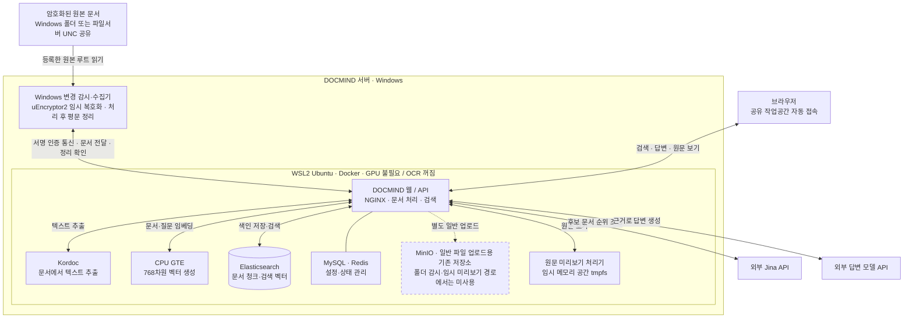
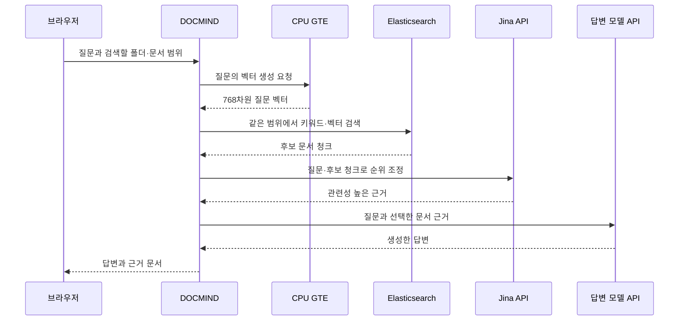
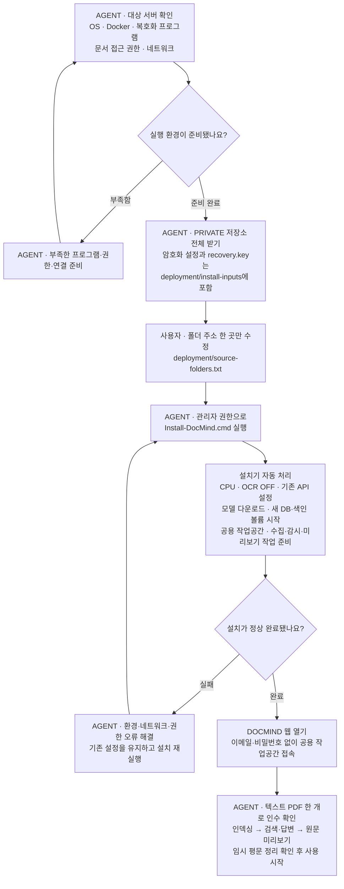

# DOCMIND — CPU 서버 설치

배포 AGENT는 먼저 **[배포 인수인계 문서](deployment/AGENT-HANDOFF.md)**를 읽으세요. 사용자의 목적과 확정된 결정, 유지할 제품 동작, 실제 구현·검증 범위 및 현장 완료 기준을 설명합니다.

현재 배포된 DOCMIND를 기준으로 정리한 제품 소스입니다. **GPU 없이 CPU로 인덱싱하며 OCR은 사용하지 않습니다.** 기존 문서·청크·벡터 DB·대화 기록은 가져오지 않습니다. 사용자가 수정할 DOCMIND 설정은 `deployment/source-folders.txt`의 문서 폴더 주소뿐입니다. 나머지 제품 설정은 설치기가 자동 적용합니다. 기존 API 키와 서버 인증 키는 이 PRIVATE 저장소에 포함된 암호화 설정과 복호화 키에서 이어받습니다.

## 구조 한눈에 보기

Windows가 원본 문서를 읽고 복호화하며, Docker 안의 DOCMIND가 문서를 분석하고 검색합니다. 브라우저에서는 공용 작업공간에 바로 접속합니다.



현재 설치에는 MinIO가 있지만, 폴더 감시 인덱싱과 임시 미리보기는 MinIO에 원본을 보관하지 않습니다. 별도의 일반 파일 업로드 경로에 의존성이 남아 있어 설치 구성에서 유지합니다. MinIO 전체 제거를 검증한 상태는 아닙니다.

**인덱싱은 문서가 바뀔 때 진행합니다.** 변경 감지 → Windows 임시 복호화 → Kordoc 텍스트 추출 → CPU GTE 벡터 생성 → Elasticsearch에 청크·벡터 저장 → 임시 평문 정리 순서입니다. 스캔 이미지의 글자는 OCR로 읽지 않습니다.

**검색과 답변은 이미 만들어 둔 색인을 사용합니다.** 질문할 때마다 전체 원본을 다시 복호화하거나 인덱싱하지 않습니다.



원문을 클릭하면 Windows에서 별도로 임시 복호화하고 미리보기 처리기가 화면용 자료를 만듭니다. 미리보기는 tmpfs에 두고 사용 후 정리합니다. 원본 루트는 배포팀이 지정한 폴더 주소를 사용합니다. VDI REST API를 통한 루트 자동 등록은 아직 구현하지 않았습니다.

## 배포 순서 한눈에 보기

**사용자는 문서 폴더 주소만 입력합니다.** 배포 AGENT가 서버 환경 준비, 기존 설정 배치, 설치와 인수 확인을 맡습니다.



사용자 승인으로 **암호화 설정과 복호화 키를 PRIVATE 저장소에 함께 포함**했습니다. 최신 `main` 전체를 받으면 별도 파일 전달이나 API 키 입력 없이 설치기가 읽습니다. 최초 설치는 새 DB·색인으로 시작하고, 재실행은 생성된 설정과 볼륨을 유지하며 설치를 재개합니다.

## 설치하는 AGENT가 먼저 읽을 내용

**새 서버가 현재 운영 서버와 같다고 가정하지 마세요.** 아래는 현재 검증한 기준 환경과 실제 제약입니다. 먼저 대상 서버를 조사하고 필요한 실행 환경을 준비한 뒤 설치합니다. 사용자가 수정하는 DOCMIND 설정은 **문서 폴더 주소 한 곳**으로 유지하고, 모델·API 키·내부 계정·포트 등을 사용자에게 다시 설정하게 하지 않습니다.

현재 운영 기능을 기준으로 웹/API·검색·동기화·미리보기 흐름을 유지하며, 이번 배포에서 달라지는 것은 GPU 대신 CPU 임베딩, OCR 비활성화, 새 문서 폴더에서 시작하는 빈 색인입니다. 기존 운영 문서·벡터·DB는 이식하지 않습니다. 대상 서버의 전체 설치/실문서 인수 시험까지 완료했다는 뜻은 아닙니다.

### 대상 환경 조사와 판단

| 확인할 사항 | AGENT가 판단하고 준비할 일 |
| --- | --- |
| OS·CPU 아키텍처 | 기준은 Windows x64 호스트와 Linux 컨테이너. CPU/GPU 종류와 메모리·디스크 여유를 확인합니다. GPU는 필요하지 않습니다. |
| PowerShell·Python·Git | Windows PowerShell 7(`pwsh`), Python 3.11+, Git의 존재와 설치 계정 실행 권한을 확인합니다. 없으면 조직의 설치 방식으로 준비합니다. Python 패키지는 설치기가 `.local/installer-python` 가상환경에 둡니다. |
| WSL·Docker | 실제 배포판 이름과 Docker 실행 위치를 확인합니다. 설치기는 접근 가능한 WSL Linux Docker를 먼저 찾고 Windows Docker CLI의 Linux engine도 확인합니다. `Ubuntu`라는 이름을 강제하지 않습니다. |
| Docker 플러그인 | 선택한 엔진에서 Compose v2(`up --wait`)와 Buildx가 필요합니다. 없으면 해당 환경에 설치합니다. 예를 들어 Ubuntu 패키지 방식은 `apt-cache policy docker-buildx`로 공급 패키지를 확인합니다. 실행 중인 다른 서비스를 중지하거나 Docker daemon을 초기화하지 않습니다. |
| 복호화 프로그램 | 전달된 운영 설정의 `uEncryptor2.exe` 경로·서명과 해당 서버의 실제 설치·라이선스·인증서를 확인합니다. 현재 캡처 경로는 `D:/uEncryptor2/uEncryptor2.exe`입니다. 설치기가 이를 이어받으며, 누락되면 AGENT가 승인된 프로그램의 배포 환경을 준비해야 합니다. |
| 문서 접근 | 설치/작업 계정이 설정한 로컬 폴더 또는 UNC 공유를 읽을 수 있어야 합니다. 다른 파일 서버의 D 드라이브를 이 서버의 D 드라이브로 간주하지 않습니다. UNC 접근 권한은 실제 작업 계정으로 확인합니다. |
| 임시 평문·보호 정책 | 임시 경로는 설치 위치의 `.local/plaintext-jobs`와 `.local/plaintext-jobs-preview`로 자동 결정합니다. 백업에서 제외하고 접근 권한·정리 동작을 확인합니다. BitLocker 요구 여부는 전달된 운영 설정을 이어받으므로 새 서버 정책과 비교합니다. 기존의 백업 제외 확인 값 자체가 새 서버에서 백업 제외를 구성해 주지는 않습니다. |
| 네트워크 | 이미지/패키지 저장소, GitHub, Hugging Face, PyTorch CPU wheel, 기존 답변 모델 및 Jina API에 접근할 수 있는지 확인합니다. 폐쇄망이면 AGENT가 승인된 이미지·wheel·모델 캐시를 사전 반입합니다. API 키나 모델을 다른 것으로 임의 교체하지 않습니다. |
| 자원·포트 | 계획 시작점은 전체 RAM 24 GB, 여유 디스크 80 GB이며 색인 규모에 따라 조정합니다. 최초 웹 빌드 힙은 8 GB입니다. 기본 loopback 포트 18080/19380이 비어 있는지 확인합니다. 충돌하면 AGENT가 기존 서비스를 식별하고 내부 배포 구성을 조정합니다. |
| 무인 실행 | 기본 Windows 작업은 설치 계정 로그인 시 실행됩니다. 로그인 전/로그아웃 후 운영이 필요하면 계정·WSL·복호화 프로그램 제약을 현장에서 검증합니다. 컨테이너 재시작 정책만으로 Windows 수집기의 무인 실행까지 보장되지 않습니다. |

환경별 판단:

- **Windows + WSL Linux Docker**: 설치기를 사용합니다. 실제 배포판 이름을 자동 탐색합니다.
- **Windows + Docker Desktop Linux engine**: 접근 가능한 Windows Docker CLI를 자동 탐색합니다. WSL 엔진과 함께 존재하면 어느 엔진을 선택했는지 설치 로그/생성 설정을 확인합니다.
- **Windows에서 필요한 프로그램이 없는 경우**: AGENT가 필수 프로그램과 복호화 환경을 먼저 준비합니다. 설치기는 환경 부족을 오류로 알리며 Docker daemon이나 운영 서비스를 임의 변경하지 않습니다.
- **Linux만 있는 서버 또는 Windows containers 모드**: 전체 DOCMIND가 그대로 실행된다고 판단하면 안 됩니다. 현재 복호화 수집기는 Windows exe와 같은 호스트의 loopback API를 사용합니다. Windows 실행 환경을 확보하거나 별도 구조 변경과 검증이 필요합니다. Linux에서 exe를 직접 실행하거나 원격 Windows worker를 단순히 URL만 바꿔 연결하는 방식은 검증되지 않았습니다.

환경에 맞춘 준비는 AGENT가 수행하되 제품의 CPU·OCR OFF·기존 API·공용 자동 접속 계약을 유지합니다. 예상과 다른 환경 때문에 실행할 수 없다면 원인을 기록하고 해당 의존성을 해결합니다. 미검증 우회로 정상 설치했다고 보고하지 않습니다.

## 1. 소스와 기존 설정 준비 — 배포 AGENT 담당

```powershell
git clone --depth 1 --single-branch --branch main https://github.com/Dongmin103/docmind-private.git C:\DocMind
Set-Location C:\DocMind
```

설치 폴더는 로컬 Windows 드라이브에 둡니다. `C:\DocMind`는 예시이며 다른 설치 경로에서도 내부 임시 경로는 자동 계산됩니다.

기존 API/서버 인증 설정을 그대로 사용하도록 다음 두 파일이 **이미 저장소에 포함되어 있습니다.** 설치기가 기본 경로에서 자동으로 읽으므로 복사·별도 전달·API 키 재입력은 필요하지 않습니다.

```text
C:\DocMind\deployment\install-inputs\
  docmind-deployed-20261019-settings.tar.enc
  recovery.key
```

32바이트 `recovery.key`와 암호화 파일은 사용자 요청으로 이 PRIVATE 저장소와 최신 설치 패키지에 함께 포함합니다. **저장소 접근자는 운영 API/인증 설정을 복원할 수 있습니다.** 저장소·복제본·설치 패키지를 비공개로 유지하고 키나 복호화한 값을 로그에 출력하지 않습니다. 암호화 파일 SHA256:

```text
01625db5b2ea5ea0808e9db77fa5f22580e394ffe4d0675c41f2c1e69e9b069b
```

설치기는 설정을 메모리에서 복호화하고 내부 파일 해시를 검사합니다. 기존 DB·문서·벡터·객체 데이터는 복원하지 않습니다.

## 2. 사용자가 바꾸는 것은 문서 폴더 주소뿐

**[deployment/source-folders.txt](deployment/source-folders.txt) 한 파일만 수정합니다.** 한 줄에 암호화 원본 폴더 하나를 입력합니다.

```text
D:/DepartmentDocuments
//fileserver/share/Department
```

주석(`#`)과 빈 줄은 무시합니다. 로컬 Windows 절대 경로나 작업 계정에서 접근 가능한 UNC 주소를 사용합니다. 최초 설치 후에는 기존 항목 순서를 유지합니다. 파일 서버의 `D:/...`는 DOCMIND 서버의 D 드라이브가 아니므로 공유 폴더라면 UNC 주소를 사용합니다.

CPU 임베딩·768차원 모델·OCR OFF·원래 API 키와 답변 API·공용 작업공간·임시 경로는 자동 적용합니다. 모델 설정이나 내부 계정 이메일을 사용자에게 입력받지 않습니다. VDI `login.do`/`folders.do`를 통한 루트 자동 등록과 사용자별 ACL 연동은 이번 설치기에 포함하지 않습니다.

## 3. 실행

환경과 기존 설정 파일을 준비한 뒤 설치 계정의 관리자 권한으로 저장소 루트의 **`Install-DocMind.cmd`를 실행합니다.** PowerShell 7에서는 다음 명령도 같습니다.

```powershell
pwsh -NoProfile -File .\tools\deployment\Install-DocMindCpuServer.ps1
```

설치기는 Python 의존성을 격리된 가상환경에 준비하고, Linux Docker 탐색 → 설정 생성 → 제품 이미지 빌드 → 고정 버전 CPU 모델 다운로드 → 새 볼륨/서비스 시작 → 내부 작업공간/문서 소스 초기화 → 수집·변경 감시·미리보기 작업 등록 순서로 진행합니다. 기존 준비 디렉터리가 있으면 키를 덮어쓰지 않고 해당 설치를 재개합니다.

**`http://127.0.0.1:18080`을 열면 기존처럼 공용 DOCMIND 작업공간에 바로 접속합니다. 이메일·비밀번호 입력은 필요하지 않으며 사용자용 초기 비밀번호/비밀번호 파일도 만들지 않습니다.** 이 주소는 서버 자체에서 접속할 때의 주소입니다. 다른 PC의 접속 주소는 배포팀이 연결한 도메인/리버스 프록시를 사용합니다.

### UI 사용 방법

웹 UI는 `app/web`의 기존 DOCMIND 화면을 이미지 빌드 시 포함하고 같은 API 컨테이너의 NGINX가 제공합니다. 별도 데스크톱 앱이나 프런트엔드 개발 서버를 실행하지 않습니다.

1. 서버에서 위 주소를 열어 로그인 화면 없이 공용 작업공간에 들어갑니다.
2. 등록한 원본 폴더의 수집·인덱싱이 진행되면 폴더/문서 목록에서 검색 범위를 선택합니다. 새 설치는 빈 색인이므로 최초 수집 전에는 기존 운영 문서가 보이지 않습니다.
3. 문서를 검색하거나 질문해 답변과 근거 문서를 확인합니다.
4. 문서를 선택해 검색에 사용되는 내용과 원문 미리보기를 확인합니다. 원문은 필요할 때 임시 복호화하며 OCR 기능은 사용하지 않습니다.

다른 PC에서는 `127.0.0.1`이 자기 PC를 가리키므로 사용할 수 없습니다. 배포 AGENT가 TLS 리버스 프록시/접속 도메인을 연결하고 실제 사용자 PC에서 접속을 검증해 주소를 전달해야 합니다. 내부 DB나 파서 포트를 외부에 공개하지 않습니다.

`.local/cpu-server`의 `server.json`, `compose.json`, `worker.json` 등은 설치기가 만든 내부 설정입니다. 일반 설치 시 사용자가 편집하지 않습니다. API 키 등이 포함되므로 Git/지원 게시물에 올리지 않습니다.

신규 문서는 빈 색인에서 CPU로 인덱싱합니다. 기본 문서 동시성과 임베딩 배치는 1이며 CPU는 GPU보다 느릴 수 있습니다. OCR은 서버에서 차단하므로 텍스트가 없는 스캔 PDF의 이미지는 인식하지 않습니다.

## 4. 설치 AGENT의 인수 확인

```powershell
pwsh -File .\tools\deployment\Start-DocMindCpuServer.ps1 -Action Status
Get-ScheduledTask | Where-Object TaskName -Like 'DocMind CPU docmind-cpu (*)' | Select-Object TaskName, State
```

선택된 Docker 엔진에서 GTE `/health`의 `device=cpu`, `dimensions=768`을 확인합니다. 웹을 열 때 로그인 화면 없이 공용 작업공간에 진입하는지 확인하고, 작은 텍스트 PDF 한 개로 폴더/문서 유입 → 인덱싱 → 검색/근거 답변 → 원문 미리보기 → 임시 평문 정리를 확인합니다. GPU나 OCR 서비스가 없어도 이 흐름이 성공해야 합니다.

외부 사용자 접속은 TLS 리버스 프록시를 loopback 웹 포트에 연결합니다. 내부 DB/파서는 호스트에 공개하지 않습니다. 자동 공용 세션은 기존 접속 방식이며 사용자별 VDI 인증/ACL 구현을 의미하지 않습니다.

환경 확인 중 수집기 자동 등록을 잠시 보류하려면 AGENT는 `-SkipWorkers`로 설치하고, 확인 후 아래 명령을 실행할 수 있습니다.

```powershell
pwsh -File .\tools\deployment\Register-DocMindCpuWorkers.ps1 -StartNow
```

설치 실패 시 환경/네트워크 오류를 해결한 뒤 설치 명령을 다시 실행합니다. 내부 단계만 재개하려면 `Start-DocMindCpuServer.ps1 -Action Build`, `DownloadModels`, `Up`, `Bootstrap`, `Status`를 사용합니다. `Bootstrap`은 같은 작업공간에 재실행할 수 있으며 다른 사용자/모델 충돌이 있는 DB는 거부합니다. 새 설치용 도구이며 기존 운영 서비스 업그레이드 도구가 아닙니다.

정지할 때는 프로젝트의 Windows 작업을 먼저 정지하고 진행 중 임시 평문 정리를 확인한 뒤 `Start-DocMindCpuServer.ps1 -Action Stop`을 실행합니다. `Stop`은 볼륨을 삭제하지 않습니다. 백업은 새 DB/색인/객체 볼륨과 별도 암호화 설정을 대상으로 구성하고 임시 평문/미리보기 tmpfs는 제외합니다.

## 제품 구성과 검증 범위

- `app/`: DOCMIND 웹/API, 검색·문서 처리 코드와 빌드 입력
- `tools/local_embedding/`: CPU GTE 서비스와 고정 모델 다운로드
- `tools/windows/`: Windows 문서 수집·변경 감시·복호화 보조 코드
- `tools/deployment/`: 설치·초기화·실행·제품 패키지 도구
- `deployment/source-folders.txt`: 사용자가 수정하는 문서 폴더 주소
- `Install-DocMind.cmd`: 기본 설치 실행 파일

범용 RAGFlow SDK·Helm·예제·다국어 문서·개발 스냅샷은 제외했습니다. DOCMIND에 필요한 내부 런타임과 Apache 라이선스/제3자 고지는 유지하며 내부 모듈/의존 이미지 이름에 `ragflow`가 남을 수 있습니다.

검증: CPU 서비스 단위 테스트 21개, OCR 비활성화 회귀 219개, 공용 세션·실제 SQLite 초기화 11개, 설정 생성·단일 폴더 목록 설정 검사, 패키지 검사 8개. CPU Linux 이미지 빌드/인증 HTTP 임베딩(768차원), 저장소에 포함한 실제 암호화 설정 복원/Compose 구문, 승인된 두 입력 외 소스에 평문 운영 비밀값을 넣지 않은 것과 별도 깨끗한 Vite production build도 확인했습니다. 기존 전체 TypeScript 검사 오류는 남아 있습니다. 위 결과는 다른 대상 서버의 전체 신규 설치와 실문서 인덱싱 인수 시험을 대신하지 않습니다.

제품 소스 ZIP 생성/검증:

```powershell
python tools/deployment/build_product_package.py --output .local/docmind-product.zip --format zip
python tools/deployment/build_product_package.py --verify .local/docmind-product.zip
```

## 배포 AGENT에게 전달할 지시문

```text
PRIVATE 저장소 https://github.com/Dongmin103/docmind-private 의 최신 main 전체를 받아 이 서버에 배포해줘.
AGENTS.md, README.md, deployment/AGENT-HANDOFF.md를 먼저 읽고 실제 서버 환경을 조사해 필요한 실행 환경을 준비해줘.
암호화 설정과 recovery.key는 deployment/install-inputs에 이미 포함되어 있으니 별도 전달을 요청하거나 API 키를 다시 입력받지 마.
사용자가 수정하는 제품 설정은 deployment/source-folders.txt의 문서 폴더 주소 한 곳뿐이야.
Install-DocMind.cmd로 설치하고 CPU 인덱싱·OCR OFF·기존 API·비밀번호 없는 공용 자동 접속을 유지해줘.
작은 문서로 수집·검색·답변·원문 미리보기·임시 정리를 검증하고, 실제 사용자 PC의 접속 주소와 남은 확인 항목을 보고해줘.
저장소/패키지와 포함된 비밀값은 외부에 공개하거나 로그에 출력하지 마.
```
