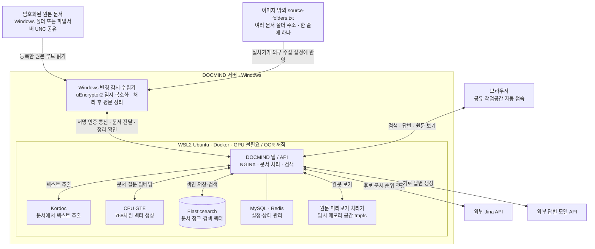
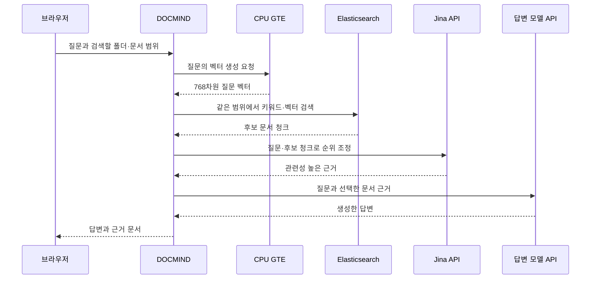
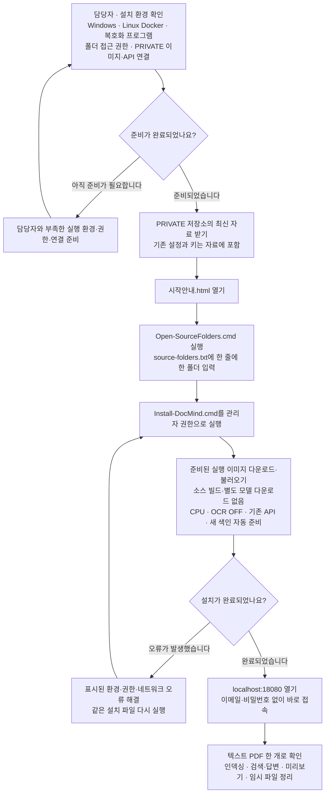

# DOCMIND 설치 안내

처음 설치하신다면 저장소 폴더의 **[시작안내.html](시작안내.html)**을 먼저 열어 주세요. 단계별 안내와 폴더 주소 예시를 함께 보실 수 있습니다. 간단한 문서 안내는 **[설치 시작 안내](deployment/START-HERE.md)**에 정리되어 있습니다.

**수정하실 제품 설정은 `deployment/source-folders.txt` 한 파일뿐입니다.** 여러 문서 폴더를 한 줄에 하나씩 적어 주시면 됩니다. 기존 운영 DOCMIND를 기준으로 준비한 CPU용 실행 이미지를 사용하므로 서버에서 소스를 다시 빌드하거나 모델을 별도로 다운로드하지 않습니다. CPU 인덱싱과 OCR 끄기, 기존 API 설정, 이메일·비밀번호 없는 공용 접속은 자동 적용됩니다.

## 먼저 준비해 주세요

| 준비 사항 | 확인하실 내용 |
| --- | --- |
| 서버 | Windows x64를 사용합니다. 컨테이너 이미지는 Linux x86_64용입니다. GPU는 필요하지 않습니다. |
| 기본 프로그램 | PowerShell 7, Python 3.11 이상, Git을 준비해 주세요. |
| Docker | WSL2의 Linux Docker 또는 Docker Desktop의 Linux 엔진과 Docker Compose v2가 실행되어 있어야 합니다. Windows containers 모드는 지원하지 않습니다. |
| 복호화 환경 | 승인된 `uEncryptor2.exe`와 인증서·라이선스가 필요합니다. 복호화 수집기는 Linux 컨테이너가 아닌 Windows 호스트에서 실행합니다. |
| 문서 권한 | 설치 계정이 등록할 로컬 폴더와 파일서버 공유 폴더를 읽을 수 있어야 합니다. 임시 복호화 경로의 보호와 백업 제외도 담당자와 확인해 주세요. |
| 네트워크 | PRIVATE 저장소·실행 이미지, 설치용 Python 패키지, 기존 답변 모델 API와 Jina API에 접근할 수 있어야 합니다. 저장소를 받은 GitHub 계정의 접근 권한도 확인해 주세요. |
| 여유 공간 | 이미지 다운로드는 약 6 GB(분할 파일 7개)이며 불러온 실행 환경은 약 20 GB입니다. 새 문서 색인 공간도 필요합니다. 계획 시작점은 RAM 24 GB, 여유 디스크 80 GB이며 실제 문서 규모에 따라 조정합니다. |

환경 준비가 필요하시면 서버 관리 담당자와 함께 확인해 주세요. Linux 전용 서버에 Windows 복호화 수집기 없이 설치하는 절차는 아닙니다. 기술 담당자께서는 [배포 인수인계 문서](deployment/AGENT-HANDOFF.md)를 함께 확인해 주세요.

## 1. 최신 PRIVATE 자료를 받아 주세요

`Dongmin103/docmind-private`의 최신 `main` 전체를 로컬 Windows 드라이브에 받아 주세요. Git을 사용하실 경우 아래와 같이 받으실 수 있습니다.

```powershell
git clone --depth 1 --single-branch --branch main https://github.com/Dongmin103/docmind-private.git C:\DocMind
```

`C:\DocMind`는 설치 폴더의 예시입니다. 다른 로컬 폴더에 설치하셔도 됩니다. 기존 API 설정과 복호화 키는 PRIVATE 자료의 `deployment/install-inputs`에 포함되어 있으므로 별도 전달이나 API 키 재입력은 필요하지 않습니다. 자료에는 운영 접속 설정이 포함되어 있으니 승인된 배포 담당자에게만 전달해 주세요.

## 2. 폴더 주소를 적어 주세요

받으신 폴더의 **`Open-SourceFolders.cmd`를 두 번 클릭**해 주세요. 실제 설정 파일인 **[deployment/source-folders.txt](deployment/source-folders.txt)**가 메모장으로 열립니다.

이 파일은 **Docker 이미지 밖에 있습니다.** 설치기가 이 목록을 Windows 수집기의 외부 설정에 반영합니다. 폴더 주소를 바꾸실 때 이미지 내부를 수정하거나 이미지를 다시 만드실 필요가 없습니다.

```text
D:/dept2
E:/계약서
//fileserver/share/Department
```

위 주소는 예시입니다. 실제 암호화 문서가 있는 폴더 주소로 바꾸어 주시고, **한 줄에 폴더 하나씩** 적어 저장해 주세요. 여러 폴더를 함께 등록하실 수 있으며 입력 순서는 상관없습니다. [폴더 주소 예시 파일](deployment/source-folders.examples.txt)은 참고용입니다.

파일서버의 `D:`와 DOCMIND 서버의 `D:`는 다릅니다. 다른 서버의 폴더는 `//fileserver/share/Department`처럼 공유 주소로 적어 주세요. API·모델·내부 계정 설정은 수정하실 필요가 없습니다.

## 3. 설치 파일을 실행해 주세요

저장소 폴더의 **`Install-DocMind.cmd`를 마우스 오른쪽 버튼으로 클릭하신 뒤 ‘관리자 권한으로 실행’**을 선택해 주세요.

설치기는 준비된 실행 이미지를 다운로드해 Docker에 불러오고, CPU 실행·기존 API 설정·새 검색 색인·공용 작업공간과 수집 작업을 자동으로 준비합니다. **소스 빌드와 Hugging Face 모델 다운로드는 진행하지 않습니다.** 기존 운영 문서·벡터 DB·대화 기록은 가져오지 않으며 새 폴더의 문서부터 인덱싱합니다.

이미지 다운로드와 불러오기에 시간이 걸릴 수 있습니다. 완료 메시지가 나올 때까지 설치 창을 닫지 말아 주세요. 인터넷 사용이 제한된 환경에서는 담당자가 승인된 이미지 파일과 설치용 패키지를 미리 준비해야 합니다.

다음 실행부터는 같은 버전의 이미지가 준비되어 있으면 다시 받지 않고 재사용합니다.

## 4. 화면을 열고 문서 한 개로 확인해 주세요

설치한 서버의 브라우저에서 **[http://localhost:18080](http://localhost:18080)**을 열어 주세요. 이메일·비밀번호 입력 없이 공용 DOCMIND 작업공간에 바로 접속합니다. 다른 PC에서는 배포 담당자가 연결한 접속 주소를 사용해 주세요.

1. 등록한 폴더의 텍스트 PDF 한 개가 문서 목록에 나타나는지 확인해 주세요.
2. 인덱싱이 완료되면 폴더·문서 목록에서 검색할 범위를 선택해 주세요.
3. 문서 내용으로 검색하거나 질문하여 답변과 근거 문서를 확인해 주세요.
4. 문서를 선택해 검색에 사용되는 내용과 원문 미리보기를 확인해 주세요.
5. 배포 담당자와 함께 임시 복호화 파일이 정리되는지 확인해 주세요.

OCR을 사용하지 않으므로 글자가 이미지로만 들어 있는 스캔 PDF 대신 **텍스트가 포함된 PDF**로 확인해 주세요. 최초 수집 전에는 문서 목록이 비어 있을 수 있습니다.

## 폴더를 추가하거나 제외하실 때

동일한 **`deployment/source-folders.txt`**에서 주소를 추가하거나 제외하여 저장하신 뒤 **`Install-DocMind.cmd`를 다시 실행**해 주세요. 폴더 목록을 반영하면서 수집 작업이 잠시 재시작될 수 있습니다. 같은 주소는 입력 순서가 달라져도 같은 폴더로 구분합니다.

진행 중인 문서 처리와 임시 파일 정리가 끝날 때까지 기다린 뒤 목록을 반영합니다. 제외한 폴더는 수집과 활성 목록에서 빠지며 원본 파일이나 기존 색인은 삭제하지 않습니다. 같은 주소를 다시 추가하시면 기존 폴더 정보에 연결합니다.

## 설치가 멈추거나 오류가 보이실 때

| 보이는 상황 | 확인하실 내용 |
| --- | --- |
| 이미지 다운로드가 되지 않습니다 | PRIVATE 저장소 접근 권한과 네트워크, 디스크 공간을 확인해 주세요. |
| Docker를 찾을 수 없습니다 | Docker의 Linux 엔진과 Compose가 실행되는지 담당자와 확인해 주세요. |
| 문서 폴더를 읽지 못합니다 | 폴더 주소가 실제로 존재하는지, 설치 계정으로 공유 폴더에 접근할 수 있는지 확인해 주세요. |
| 복호화에 실패합니다 | 승인된 프로그램의 설치·인증서·라이선스와 파일 접근 권한을 확인해 주세요. |
| 다른 PC에서 화면이 열리지 않습니다 | `localhost`는 접속한 PC 자신을 뜻합니다. 배포 담당자가 연결한 서버 주소로 접속해 주세요. |

표시된 오류 원인을 해결하신 뒤 같은 설치 파일을 다시 실행해 주세요. 기존 설정이나 Docker 데이터를 임의로 삭제하지 말아 주세요. 새 서버의 전체 설치와 실제 문서 확인은 현장에서 마무리해 주셔야 합니다.

## 구조 한눈에 보기

Windows가 문서를 읽고 임시 복호화하며, Docker 안의 DOCMIND가 문서를 분석하고 검색합니다. 원본 암호화 문서는 지정한 폴더에 남고 임시 평문은 처리 후 정리합니다.



인덱싱은 문서가 바뀔 때 진행합니다. 텍스트를 추출하고 CPU로 검색 벡터를 만들어 저장합니다. 검색과 답변은 이미 만들어 둔 색인을 사용하므로 질문할 때마다 전체 원본을 다시 복호화하지 않습니다.



원문 미리보기는 필요할 때 별도로 임시 복호화해 보여 드리고 사용 후 정리합니다. VDI REST API를 통한 폴더 자동 등록·사용자별 권한 연동은 아직 포함하지 않습니다.

## 배포 순서 한눈에 보기



## 함께 제공하는 시작 자료

- [시작안내.html](시작안내.html): 오프라인으로 열 수 있는 단계별 화면과 폴더 주소 복사 예시
- [deployment/START-HERE.md](deployment/START-HERE.md): 짧은 설치 순서
- [deployment/source-folders.examples.txt](deployment/source-folders.examples.txt): 여러 폴더 주소 작성 예시
- `Open-SourceFolders.cmd`: 실제 폴더 목록을 메모장으로 여는 파일
- `Install-DocMind.cmd`: 기본 설치 실행 파일
- [deployment/AGENT-HANDOFF.md](deployment/AGENT-HANDOFF.md): 담당자용 기술 기준과 검증 범위

필요한 DOCMIND 내부 처리 코드와 라이선스는 유지합니다. 내부 파일이나 의존 이미지에 남아 있는 `ragflow` 이름을 보고 별도 범용 제품을 새로 설치하실 필요는 없습니다.

## 배포 에이전트에 전달하실 문구

아래 내용을 복사하여 PRIVATE 저장소 주소와 함께 전달하실 수 있습니다.

```text
Dongmin103/docmind-private의 최신 main으로 DOCMIND를 새 서버에 설치해 주세요.
먼저 AGENTS.md, README.md, deployment/AGENT-HANDOFF.md를 읽고 실제 서버의
Windows·Linux Docker·복호화 프로그램·공유 폴더 권한·네트워크·자원을 확인해 주세요.
기존 서버와 환경이 같다고 가정하지 말고 부족한 실행 환경은 현장에서 준비해 주세요.
시작안내.html과 Open-SourceFolders.cmd로 담당자가 문서 폴더 주소만 입력하도록
안내해 주세요. 여러 드라이브와 UNC 공유 폴더를 한 목록에 등록할 수 있어야 합니다.
Install-DocMind.cmd로 PRIVATE Release의 준비된 이미지를 불러와 실행해 주세요.
대상 서버에서 소스/UI를 다시 빌드하거나 Hugging Face 모델을 받지 않습니다.
CPU 인덱싱·OCR OFF·기존 API 설정·비밀번호 없는 공용 접속을 유지해 주세요.
암호화 설정과 recovery.key는 PRIVATE 자료에 포함되어 있습니다.
기존 운영 문서·DB·벡터는 이전하지 않으며 다른 운영 서비스를 중지하거나 초기화하지 마세요.
설치 후 승인된 작은 텍스트 문서로 수집·검색/답변·원문 보기·임시 파일 정리를
확인하고, 접속 주소·재시작 조건·검증 결과와 남은 현장 제약을 기록해 주세요.
```
